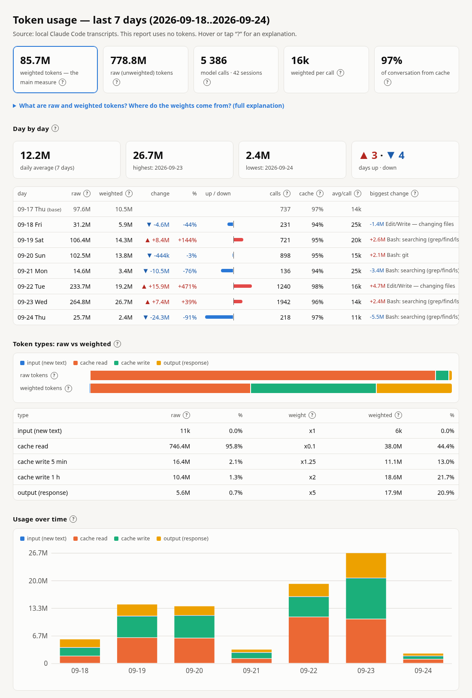

# claude_token_report

Shows **where your Claude Code tokens actually go**: which activities (reading files, searching,
editing, git, subagents...), which models, projects and sessions. It also shows how much long
conversations and an expired cache add to your usage, and which files and classes Claude keeps
looking up in every new conversation, with a draft of what to add to `CLAUDE.md`.

- reads only local transcripts (`~/.claude/projects/**/*.jsonl`)
- sends nothing and calls no API, so it uses **0 tokens**
- Python 3.8+, standard library only, no dependencies
- English by default, Polish with `-l pl`

## Example

Real usage from one week, with project names, file names and prompts hidden (`--private`).

**Terminal** (`claude-token-report --daily --private`, the beginning):

```
============================================================================================
 CLAUDE CODE TOKEN USAGE — last 7 days (2026-09-18..2026-09-24)
 source: local transcripts ~/.claude/projects  (this report uses 0 tokens)
============================================================================================
 model calls                      5 386   42 conversations, 88 subagents
 raw tokens                      778.8M   all tokens counted equally
 weighted tokens                  85.7M   main measure — load on your limit (--explain)
 cache hit rate                   96.5%   above ~90% is good
 average per call                   16k   weighted; avg context 144k

-- TOKEN TYPES — raw vs weighted -----------------------------------------------------------
 token type                      raw      %  weight  weighted      %
 input (new text)                11k   0.0%      x1        6k   0.0%
 cache read                   746.4M  95.8%    x0.1     38.0M  44.4%
 cache write 5 min             16.4M   2.1%   x1.25     11.1M  13.0%
 cache write 1 h               10.4M   1.3%      x2     18.6M  21.7%
 output (response)              5.6M   0.7%      x5     17.9M  20.9%
 TOTAL                        778.8M                    85.7M
   Weighted also includes the model's weight (see MODELS).

-- WHERE THE TOKENS GO ---------------------------------------------------------------------
   Each call is assigned to the tool the model used in it (split evenly if it used
   several). 'No tool' = the model replied to you with text. 'avg' = the average weight of
   one use.
 activity                              raw  weighted      %    uses      avg  
 Bash: searching (grep/find/ls)     190.4M     19.9M  23.2%    1580      13k  │▮▮▮▮▮▯▯▯▯▯▯▯▯▯▯▯▯▯▯
 Edit/Write — changing files        163.7M     15.2M  17.7%    1177      13k  │▮▮▮▮▯▯▯▯▯▯▯▯▯▯▯▯▯▯▯
 Read — reading files               162.4M     14.6M  17.1%    1738       8k  │▮▮▮▯▯▯▯▯▯▯▯▯▯▯▯▯▯▯▯
 Bash: scripts (python/node/sh/o     66.5M      7.5M   8.8%     518      15k  │▮▮▯▯▯▯▯▯▯▯▯▯▯▯▯▯▯▯▯
 Bash: git                           57.9M      6.9M   8.1%     499      14k  │▮▮▯▯▯▯▯▯▯▯▯▯▯▯▯▯▯▯▯
 (no tool) text reply                45.9M      5.9M   6.9%     278      21k  │▮▯▯▯▯▯▯▯▯▯▯▯▯▯▯▯▯▯▯
 Bash: reading (cat/head/sed)        32.8M      5.3M   6.2%     274      19k  │▮▯▯▯▯▯▯▯▯▯▯▯▯▯▯▯▯▯▯
 Agent — launching a subagent        10.8M      3.3M   3.9%     161      21k  │▮▯▯▯▯▯▯▯▯▯▯▯▯▯▯▯▯▯▯
 Bash: devices (adb/emulator/xcr     10.6M      1.6M   1.9%      96      17k  │▮▯▯▯▯▯▯▯▯▯▯▯▯▯▯▯▯▯▯
 Skill                                6.7M      1.4M   1.7%      79      18k  │▮▯▯▯▯▯▯▯▯▯▯▯▯▯▯▯▯▯▯
 Bash: other                          4.1M      797k   0.9%      32      25k  │▮▯▯▯▯▯▯▯▯▯▯▯▯▯▯▯▯▯▯
 Bash: file operations                6.2M      767k   0.9%      44      17k  │▮▯▯▯▯▯▯▯▯▯▯▯▯▯▯▯▯▯▯
 asking the user                      3.6M      562k   0.7%      22      26k  │▮▯▯▯▯▯▯▯▯▯▯▯▯▯▯▯▯▯▯
 Bash: processes/waiting (ps/sle      1.5M      383k   0.4%      11      35k  │▯▯▯▯▯▯▯▯▯▯▯▯▯▯▯▯▯▯▯
 Bash: browser automation             5.1M      360k   0.4%      48       8k  │▯▯▯▯▯▯▯▯▯▯▯▯▯▯▯▯▯▯▯
 Bash: gh (GitHub/GitLab CLI)         1.2M      360k   0.4%      19      19k  │▯▯▯▯▯▯▯▯▯▯▯▯▯▯▯▯▯▯▯
 (other: 7)                           9.5M      666k   0.8%
```

The bar after `│` shows the row's share of the total (in the period table: of the busiest period). With color the filled part is cyan and the rest is dim.

<details>
<summary>The whole terminal report</summary>

```

-- DAY BY DAY — change vs the previous day -------------------------------------------------
 day                    raw   weighted    change      %   calls  cache  avg/call  biggest change
 09-17 Thu (base)     97.6M      10.5M                      737    97%       14k
 09-18 Fri            31.2M ▼     5.9M     -4.6M   -44%     231    94%       25k  -1.4M Edit/Write — changing files
 09-19 Sat           106.4M ▲    14.3M     +8.4M  +144%     721    95%       20k  +2.6M Bash: searching (grep/find/ls)
 09-20 Sun           102.5M ▼    13.8M     -444k    -3%     898    95%       15k  +2.1M Bash: git
 09-21 Mon            14.6M ▼     3.4M    -10.5M   -76%     136    94%       25k  -3.4M Bash: searching (grep/find/ls)
 09-22 Tue           233.7M ▲    19.2M    +15.9M  +471%    1240    98%       16k  +4.7M Edit/Write — changing files
 09-23 Wed           264.8M ▲    26.7M     +7.4M   +39%    1942    96%       14k  +2.4M Bash: searching (grep/find/ls)
 09-24 Thu            25.7M ▼     2.4M    -24.3M   -91%     218    97%       11k  -5.5M Bash: searching (grep/find/ls)

 daily average 12.2M   highest 2026-09-23 (26.7M)   lowest 2026-09-24 (2.4M)   days ▲ 3 / ▼ 4
   Changes in weighted tokens. ▲ = more than the day before, ▼ = less, = unchanged (±1%).
   'biggest change' = the activity whose usage changed the most.

============================================================================================
 CLAUDE CODE TOKEN USAGE — last 7 days (2026-09-18..2026-09-24)
 source: local transcripts ~/.claude/projects  (this report uses 0 tokens)
============================================================================================
 model calls                      5 386   42 conversations, 88 subagents
 raw tokens                      778.8M   all tokens counted equally
 weighted tokens                  85.7M   main measure — load on your limit (--explain)
 cache hit rate                   96.5%   above ~90% is good
 average per call                   16k   weighted; avg context 144k

-- TOKEN TYPES — raw vs weighted -----------------------------------------------------------
 token type                      raw      %  weight  weighted      %
 input (new text)                11k   0.0%      x1        6k   0.0%
 cache read                   746.4M  95.8%    x0.1     38.0M  44.4%
 cache write 5 min             16.4M   2.1%   x1.25     11.1M  13.0%
 cache write 1 h               10.4M   1.3%      x2     18.6M  21.7%
 output (response)              5.6M   0.7%      x5     17.9M  20.9%
 TOTAL                        778.8M                    85.7M
   Weighted also includes the model's weight (see MODELS).

-- WHERE THE TOKENS GO ---------------------------------------------------------------------
   Each call is assigned to the tool the model used in it (split evenly if it used
   several). 'No tool' = the model replied to you with text. 'avg' = the average weight of
   one use.
 activity                              raw  weighted      %    uses      avg  
 Bash: searching (grep/find/ls)     190.4M     19.9M  23.2%    1580      13k  │▮▮▮▮▮▯▯▯▯▯▯▯▯▯▯▯▯▯▯
 Edit/Write — changing files        163.7M     15.2M  17.7%    1177      13k  │▮▮▮▮▯▯▯▯▯▯▯▯▯▯▯▯▯▯▯
 Read — reading files               162.4M     14.6M  17.1%    1738       8k  │▮▮▮▯▯▯▯▯▯▯▯▯▯▯▯▯▯▯▯
 Bash: scripts (python/node/sh/o     66.5M      7.5M   8.8%     518      15k  │▮▮▯▯▯▯▯▯▯▯▯▯▯▯▯▯▯▯▯
 Bash: git                           57.9M      6.9M   8.1%     499      14k  │▮▮▯▯▯▯▯▯▯▯▯▯▯▯▯▯▯▯▯
 (no tool) text reply                45.9M      5.9M   6.9%     278      21k  │▮▯▯▯▯▯▯▯▯▯▯▯▯▯▯▯▯▯▯
 Bash: reading (cat/head/sed)        32.8M      5.3M   6.2%     274      19k  │▮▯▯▯▯▯▯▯▯▯▯▯▯▯▯▯▯▯▯
 Agent — launching a subagent        10.8M      3.3M   3.9%     161      21k  │▮▯▯▯▯▯▯▯▯▯▯▯▯▯▯▯▯▯▯
 Bash: devices (adb/emulator/xcr     10.6M      1.6M   1.9%      96      17k  │▮▯▯▯▯▯▯▯▯▯▯▯▯▯▯▯▯▯▯
 Skill                                6.7M      1.4M   1.7%      79      18k  │▮▯▯▯▯▯▯▯▯▯▯▯▯▯▯▯▯▯▯
 Bash: other                          4.1M      797k   0.9%      32      25k  │▮▯▯▯▯▯▯▯▯▯▯▯▯▯▯▯▯▯▯
 Bash: file operations                6.2M      767k   0.9%      44      17k  │▮▯▯▯▯▯▯▯▯▯▯▯▯▯▯▯▯▯▯
 asking the user                      3.6M      562k   0.7%      22      26k  │▮▯▯▯▯▯▯▯▯▯▯▯▯▯▯▯▯▯▯
 Bash: processes/waiting (ps/sle      1.5M      383k   0.4%      11      35k  │▯▯▯▯▯▯▯▯▯▯▯▯▯▯▯▯▯▯▯
 Bash: browser automation             5.1M      360k   0.4%      48       8k  │▯▯▯▯▯▯▯▯▯▯▯▯▯▯▯▯▯▯▯
 Bash: gh (GitHub/GitLab CLI)         1.2M      360k   0.4%      19      19k  │▯▯▯▯▯▯▯▯▯▯▯▯▯▯▯▯▯▯▯
 (other: 7)                           9.5M      666k   0.8%

-- MODELS ----------------------------------------------------------------------------------
   'weight' = how heavily the model uses the limit relative to Opus 5 (x1). The same work
   on a x0.4 model uses 2.5 times less.
 model                                 raw  weighted      %   calls      avg weight  
 claude-opus-5                      146.4M     36.6M  42.7%     859      43k     x1  │▮▮▮▮▮▮▮▮▮▯▯▯▯▯▯▯▯▯▯
 claude-sonnet-5                    511.8M     32.4M  37.9%    3517       9k   x0.4  │▮▮▮▮▮▮▮▮▯▯▯▯▯▯▯▯▯▯▯
 claude-opus-5-5                    120.6M     16.7M  19.5%    1010      17k   x0.8  │▮▮▮▮▯▯▯▯▯▯▯▯▯▯▯▯▯▯▯

-- MAIN SESSION vs SUBAGENTS ---------------------------------------------------------------
   Subagents are separate Claude instances started with the Agent tool. They have their own
   context, so their work doesn't grow the main conversation.
 where                                 raw  weighted      %   calls      avg  
 main session                       245.4M     43.4M  50.6%    1617      27k  │▮▮▮▮▮▮▮▮▮▮▯▯▯▯▯▯▯▯▯
 subagents                          533.5M     42.3M  49.4%    3769      11k  │▮▮▮▮▮▮▮▮▮▮▯▯▯▯▯▯▯▯▯

-- SUBAGENTS BY TYPE -----------------------------------------------------------------------
 subagent type                         raw  weighted      %   calls      avg  
 agent-3                            409.0M     31.5M  36.7%    2495      13k  │▮▮▮▮▮▮▮▯▯▯▯▯▯▯▯▯▯▯▯
 general-purpose                     86.9M      6.8M   7.9%     898       8k  │▮▮▯▯▯▯▯▯▯▯▯▯▯▯▯▯▯▯▯
 fork                                14.7M      1.5M   1.7%     127      12k  │▮▯▯▯▯▯▯▯▯▯▯▯▯▯▯▯▯▯▯
 agent-2                              7.1M      1.4M   1.6%      75      18k  │▮▯▯▯▯▯▯▯▯▯▯▯▯▯▯▯▯▯▯
 agent-1                             15.8M      1.2M   1.4%     174       7k  │▮▯▯▯▯▯▯▯▯▯▯▯▯▯▯▯▯▯▯

-- PROJECTS (working directory) ------------------------------------------------------------
 project                               raw  weighted      %   calls      avg  
 project-1                          749.9M     81.9M  95.6%    5198      16k  │▮▮▮▮▮▮▮▮▮▮▮▮▮▮▮▮▮▮▮
 project-3                           15.3M      2.0M   2.4%     116      18k  │▮▯▯▯▯▯▯▯▯▯▯▯▯▯▯▯▯▯▯
 project-2                           13.6M      1.8M   2.1%      72      24k  │▮▯▯▯▯▯▯▯▯▯▯▯▯▯▯▯▯▯▯

-- CONVERSATION LENGTH — weight of a call by context size ----------------------------------
   Context = the whole conversation the model reads in a call. It grows with every step and
   the model re-reads it every time, so the longer the conversation, the more each further
   call weighs.
 context          calls       raw  weighted      %    avg/call   of it reading
 < 50k              267     11.3M      3.4M   4.0%         13k              1k
 50-100k           1803    140.8M     17.6M  20.5%         10k              3k
 100-200k          2188    311.1M     31.9M  37.2%         15k              7k
 200-300k           795    191.6M     17.7M  20.7%         22k             12k
 300k+              333    124.0M     15.1M  17.7%         45k             21k
   A call at 300k+ context weighs 4.7x as much as one at 50-100k on average. 'of it
   reading' = the part spent only on re-reading the conversation. The '< 50k' group is
   often conversation starts, which first write everything to the cache.

-- OVER TIME — days ------------------------------------------------------------------------
 period                          raw  weighted      %   calls  
 2026-09-18 Fri                31.2M      5.9M   6.8%     231  │▮▮▮▮▮▮▯▯▯▯▯▯▯▯▯▯▯▯▯▯▯▯▯▯▯
 2026-09-19 Sat               106.4M     14.3M  16.7%     721  │▮▮▮▮▮▮▮▮▮▮▮▮▮▮▯▯▯▯▯▯▯▯▯▯▯
 2026-09-20 Sun               102.5M     13.8M  16.2%     898  │▮▮▮▮▮▮▮▮▮▮▮▮▮▯▯▯▯▯▯▯▯▯▯▯▯
 2026-09-21 Mon                14.6M      3.4M   3.9%     136  │▮▮▮▯▯▯▯▯▯▯▯▯▯▯▯▯▯▯▯▯▯▯▯▯▯
 2026-09-22 Tue               233.7M     19.2M  22.5%    1240  │▮▮▮▮▮▮▮▮▮▮▮▮▮▮▮▮▮▮▮▯▯▯▯▯▯
 2026-09-23 Wed               264.8M     26.7M  31.1%    1942  │▮▮▮▮▮▮▮▮▮▮▮▮▮▮▮▮▮▮▮▮▮▮▮▮▮
 2026-09-24 Thu                25.7M      2.4M   2.8%     218  │▮▮▯▯▯▯▯▯▯▯▯▯▯▯▯▯▯▯▯▯▯▯▯▯▯

 trend of top activities (weighted tokens):
                                            09-18   09-19   09-20   09-21   09-22   09-23   09-24
 Bash: searching (grep/find/ls)              958k    3.5M    4.2M    808k    3.7M    6.1M    599k
 Edit/Write — changing files                 797k    2.9M    1.5M    137k    4.8M    4.8M    286k
 Read — reading files                        981k    2.8M    2.4M    292k    3.7M    4.1M    401k
 Bash: scripts (python/node/sh/own)          747k    873k    754k    757k    858k    3.2M    322k
 Bash: git                                   170k    347k    2.4M     55k    1.2M    2.6M    105k
 (no tool) text reply                        576k    880k    349k    636k    1.5M    1.7M    208k

-- HEAVIEST CONVERSATIONS ------------------------------------------------------------------
 session   project                    raw  weighted      %  calls  max ctx    sub  topic
 f2aff469  project-1               298.4M     22.4M  26.2%   1539     424k    69%  
 7069c87d  project-1               103.5M     13.5M  15.8%    715     290k    70%  
 518f740c  project-1                34.3M      7.2M   8.4%    238     465k    35%  
 6b14de2f  project-1                50.9M      4.1M   4.8%    536      49k   100%  
 d59ca19f  project-1                18.8M      3.9M   4.5%     44     465k     0%  
 950df66a  project-1                20.0M      3.8M   4.4%    124     262k     0%  
 beea9669  project-1                14.0M      2.5M   2.9%    124     158k    68%  
 576b5390  project-1                38.5M      2.1M   2.4%    222     275k     0%  
 85b54a3a  project-1                22.1M      2.0M   2.4%    180     246k    45%  
 29d533c5  project-1                13.7M      1.9M   2.3%    118     155k    69%  
   'max ctx' = how large the conversation grew; 'sub' = the share of this session's usage
   spent by subagents. One session in detail: --session <id>

-- EXPIRED CACHE — conversation written again ----------------------------------------------
   The cache keeps the conversation for 5 minutes or 1 hour after its last use (the
   transcript records which). After a longer break the model writes the whole conversation
   again instead of reading it:
     write, 5 min cache   x1.25
     write, 1 h cache     x2
     read (both)          x0.1, x0.05 or less in newer models

 such calls: 67   extra usage: 12.9M (15.1% of the total)

 pause before the rewrite:
    < 5 min    10
    5-60 min   40
    > 60 min   17
   A pause shorter than the cache lifetime ('< 5 min', and with the 1 h cache also '5-60
   min') means time did not cause the rewrite (e.g. a model switch or a change in an
   earlier part of the conversation). The pause is counted from the previous call of the
   same conversation file.

 sessions with the most rewrites:
    d59ca19f   10×  extra   2.7M  longest pause  1203 min
    518f740c    5×  extra   1.5M  longest pause    67 min

 largest single events:
    2026-09-20 20:05  d59ca19f  ctx  435k  gap   67 min  extra 767k
    2026-09-19 15:23  518f740c  ctx  410k  gap 1662 min  extra 737k
    2026-09-23 08:11  f2aff469  ctx  410k  gap  234 min  extra 736k
    2026-09-18 11:37  518f740c  ctx  367k  gap    1 min  extra 653k
    2026-09-23 03:11  f2aff469  ctx  359k  gap  214 min  extra 640k

-- REPEATED FILE READS (Read tool) ---------------------------------------------------------
 reads: 1738, part already in the conversation: 197 (11%)
    file-38.md                                          +32
    file-4.md                                           +19
    file-34.kt                                          +13
    file-41.kt                                          +11
    file-35.kt                                          +9
    file-5.md                                           +7

-- WHAT YOU COULD IMPROVE ------------------------------------------------------------------
 * Long conversations: calls with more than 200k of context are 38% of usage, and each of
   them weighs more than a call in a short conversation (~4.7x). Start unrelated tasks with
   /clear and shorten long work with /compact.
 * Expired cache: 67 times the whole conversation was written again (usually after a break
   of more than the cache lifetime: 5 minutes or an hour). That is 15% of usage that could have been avoided. Finish the
   thread before a long break, and consider /compact or /clear when you return to an old
   conversation.
 * Searching and reading code is 47% of usage. Name concrete files or functions in your
   request, describe the project layout in CLAUDE.md, and hand broad searches to a subagent
   (e.g. "use a subagent to find…"). Its working reads stay out of the main conversation;
   only the result comes back.

 Full explanation of raw and weighted tokens: --explain
============================================================================================
```

</details>

**HTML** (`--html report.html`), the top of the page; every number has a `?` with an explanation:



## Install

Works on Linux, macOS and Windows, anywhere Claude Code keeps its transcripts in
`~/.claude/projects` (on Windows `%USERPROFILE%\.claude\projects`).

**As a command** (recommended), with [pipx](https://pipx.pypa.io) or [uv](https://docs.astral.sh/uv/):

```bash
pipx install git+https://github.com/dgrebowiec/claude-token-report
# or: uv tool install git+https://github.com/dgrebowiec/claude-token-report
claude-token-report --help
```

Update with `pipx upgrade claude-token-report` (or `uv tool upgrade claude-token-report`);
`claude-token-report --version` shows which version you have.
Try it once without installing: `uvx --from git+https://github.com/dgrebowiec/claude-token-report claude-token-report`

**Or just clone it**, since there is nothing to install:

```bash
git clone https://github.com/dgrebowiec/claude-token-report.git
cd claude-token-report
python3 claude_token_report.py --help
```

The examples below use `python3 claude_token_report.py` (on Windows usually `py claude_token_report.py`);
with pipx/uv just type `claude-token-report` instead.

## Usage

```bash
python3 claude_token_report.py                  # last 7 days in the terminal
python3 claude_token_report.py --explain        # what raw and weighted tokens mean
python3 claude_token_report.py --days 14 --daily         # last 14 days + each day's rise/fall
python3 claude_token_report.py --date 2026-09-15         # one specific day
python3 claude_token_report.py --from 09-01 --to 09-15   # a date range (inclusive)
python3 claude_token_report.py --today --diff   # today vs yesterday
python3 claude_token_report.py -l pl            # Polish
python3 claude_token_report.py --short          # main numbers, activities, models, heaviest conversations
python3 claude_token_report.py --bash --long    # the default report + Bash noise, longer tables
python3 claude_token_report.py --only models,cache      # only these elements (and the summary)
python3 claude_token_report.py --list           # recent sessions
python3 claude_token_report.py --session 1a2b   # one session in detail (no value = the latest)
python3 claude_token_report.py --session 1a2b --short    # the session details, activities and phases
python3 claude_token_report.py --html report.html --private   # shareable HTML, no names or prompts
python3 claude_token_report.py --md report.md --daily            # Markdown for Claude to analyze (every section by default, with task and glossary)
python3 claude_token_report.py --short --diff --dry-run          # what the report would contain, nothing read
```

Dates: `YYYY-MM-DD`, `DD.MM.YYYY`, `MM-DD` (current year), `today`, `yesterday`.
How the options combine: [What the report shows](#what-the-report-shows-options).

`--daily` compares every day with the day before it: the change in weighted tokens (▲/▼), cache hit rate,
usage per call and the activity that changed the most. It works in the terminal and in the HTML report.
In the HTML report every metric has a `?` you can hover over or tap for an explanation.

## One session in detail

`--session <id>` (an id or its prefix from `--list`) adds **SESSION DETAILS** to the report:

- project, git branch, Claude Code version, start, end and duration, requests and compactions
- cache rewrites (how many times the conversation was written again, the extra usage and the
  longest pause before one) and calls at a context of 150k tokens or more
- every model with its calls (and how many of them subagents made), input, cache read, cache write,
  output and weighted tokens
- the effort level of the calls (`low` ... `max`), whether **ultracode** was on (when it was switched
  on, requests with the `ultracode` keyword, Workflow runs), and fast mode
- every subagent: type, model, calls, weighted tokens and its task; agents started by a Workflow run
  are included
- skills used, the files read and changed (with the share of usage spent on them) and the most
  frequent searches

In the HTML report you can click any row in **Heaviest conversations** to see the same details
for that session.

## Project map: what to put in CLAUDE.md

Every new conversation starts without knowing your project, so Claude finds the same files and
classes again: it greps for `UserManager`, reads the 3000-line `MainActivity.kt` in pieces, and so on.
The **PROJECT MAP** section lists, for up to three projects:

- **files** Claude read at least 5 times across at least 2 conversations, with their length
  (`large` = over 800 lines, read in pieces)
- **symbols** (camelCase / snake_case names) it searched for with Grep, Glob, `grep`, `rg`,
  `git grep`, `find -name` or `fd`. A `grep` that filters piped output (`git log | grep foo`)
  is not counted, nor is a search in another directory
- whether each one is already mentioned (by its exact name) in what Claude Code loads as instructions: `CLAUDE.md`,
  `.claude/CLAUDE.md` and `CLAUDE.local.md` (in the project and above it), their `@imports`,
  `.claude/rules/`, `~/.claude/CLAUDE.md`, and `AGENTS.md` when there is no `CLAUDE.md`.
  `via link` means it is in a `.md` file those instructions link to (say, a project map Claude
  is told to read first), which loads only when Claude reads it.
  This is a text search with limits: it follows links one level deep, does not read skills,
  auto memory or `CLAUDE.md` files in subdirectories, and does not recognise a description
  without the exact name. So `not found` means *probably missing*: check before you add it
- a draft to paste into `CLAUDE.md`, one line per missing item; you fill in the `…`:

```markdown
## Project map
- `app/src/main/java/com/example/MainActivity.kt` — …
- `UserManager` — `app/src/main/java/com/example/data/UserManager.kt` — …
```

It also warns when an instruction file has more than 200 lines: it loads in every conversation,
and [the Claude Code docs](https://code.claude.com/docs/en/memory) advise keeping it shorter and
moving guidance for one part of the code to `.claude/rules/` with a `paths:` field.
With `--private` the section is hidden, since file and class names reveal the project.

## What the report shows: options

Each option sets one of a few independent things, so they combine freely. A combination that
cannot work stops with an error; nothing is dropped without a word.

| What | Values | Set by |
| :--- | :--- | :--- |
| period | last 7 days by default; `--days`, `--date`, `--from`/`--to`, `--today`, `--yesterday`, `--all`, `--rolling` | one of these flags |
| scope | all history in the period, or one session | `--session` |
| elements | the summary (always) + `activities`, `models`, `sessions`, `tips`, `time`, `breakdown`, `cache`, `bash`, `skills`, `map` | saved configuration, `--short` / `--full`, `--only`, section flags |
| table length | `compact` (rankings of 5 rows) or `long` (10 rows) | saved configuration, `--full`, `--long` |
| modifiers | `--diff`, `--daily` | flags |

### Elements

The default report is short (about 75 lines): the summary, where the tokens go (`activities`),
`models`, the heaviest conversations (`sessions`) and **what you could improve** (`tips`).
A tip about something that is not shown ends with the flag that shows it (`Details: --cache`).
Add sections as you need them; the same flags work for `--html` and `--md`:

| Flag | Element | Adds |
| :--- | :--- | :--- |
| `--time` | `time` | token types (raw vs weighted) and usage over time |
| `--breakdown` | `breakdown` | main session vs subagents, subagent types, projects |
| `--cache` | `cache` | conversation length, expired cache, long conversations, repeated file reads (below) |
| `--bash` | `bash` | Bash noise (below) |
| `--skills` | `skills` | skills (below) |
| `--project-map` | `map` | the project map (above) |

Flags combine: `claude-token-report --bash --skills --html report.html`.

### Presets and `--only`

A preset is only a named set of elements and a table length, not a different kind of report:

| Option | Elements | Tables |
| :--- | :--- | :--- |
| nothing (and no saved configuration) | `activities`, `models`, `sessions`, `tips` | compact |
| `--short` | `activities`, `models`, `sessions` | compact |
| `--full` | every element | long |
| `--only LIST` | the listed elements, comma-separated (`--only models,cache`) | compact |
| `--md FILE` with no preset, `--only`, section flag or saved configuration | every element | long |
| saved configuration (`--configure`) | the saved elements | the saved length |

So `--short --bash` is the short set plus Bash noise, `--short --long` the short set with long
tables, and `--short --diff` / `--short --daily` keep the comparison and the day by day view,
in the HTML report too. Elements always come in the fixed order `activities`, `models`, `sessions`,
`tips`, `time`, `breakdown`, `cache`, `bash`, `skills`, `map`, whatever the order in `--only`.

### Table length: `--long`

`--long` makes the rankings longer and changes nothing else: activities 8 → 16 rows (20 in HTML),
models 5 → 10, heaviest conversations 5 → 10 (15 in HTML), skills 5 → 10 per list. `tips`, `time`,
`breakdown`, `cache`, `bash` and `map` have no tables of variable length, so `long` does not change
them (`--dry-run` and the configurator say so). `--full` is every element plus `--long`.

### Which option wins

1. Conflicting options in one command are an error (below).
2. `--short`, `--full` or `--only` replaces the saved set of elements and its table length for that
   run (add `--long` for long tables).
3. A section flag **adds** its section to the base set (the saved configuration, the preset or the
   default set): with `activities` and `cache` saved, `--bash` shows activities, cache and Bash noise.
4. `--no-config` ignores the saved configuration for that run.
5. `--diff` and `--daily` work on what is in the report; they never turn on a hidden element.

These stop with an error (exit code 2) and say why:

| Combination | Why |
| :--- | :--- |
| `--short --full`, `--only` with `--short` or `--full` | each picks the set of elements |
| `--session --diff`, `--all --diff` | there is no previous window to compare with |
| more than one way to set the period (`--days 3 --today`) | one period at a time |
| `--list`, `--explain`, `--configure`, `--reset-config` with a report option (`--list --bash`) or with each other | they are separate commands |
| an unknown name in `--only` | the message lists the allowed names |

`--lang`, `--color` / `--no-color` and `--dir` work with everything. `--session --daily` and
`--all --daily` work (the days of one session, of all history).

### `--diff` follows the elements

The comparison with the previous window always has the general numbers (model calls, raw and
weighted tokens, average per call, cache hit rate) and a part for each element in the report that
can be compared: `activities`, `models`, `time` (token types), `breakdown` (projects), `cache`
(share of long conversations and of the expired cache) and `bash` (share of Bash noise).
`sessions`, `tips`, `skills` and `map` have no comparison; a line under it names the ones in the
report (`Not compared: sessions, tips`). The terminal, HTML and Markdown show the same parts.

### Report footer

Every report (terminal, HTML and Markdown) ends with the settings behind it: where the set of
elements came from, the table length, the comparison, and what to add or change. For example,
`--short --diff`:

```
 Settings: --short · compact tables (5 rows) · compared with 2026-10-12..2026-10-18 (7 days), not compared: sessions
 More detail: --time --breakdown --cache --bash --skills --project-map  or --full (everything)
 Your own saved set: --configure · raw and weighted tokens: --explain
```

### `--dry-run`: check the options first

`--dry-run` prints what the report would contain and stops. It reads no transcripts and writes no
`--html` / `--md` file, but option errors work as usual. `--short --bash --diff --dry-run`:

```
--dry-run: what the report would show — nothing counted, no transcripts read
 Period:       last 7 days (2026-10-19..2026-10-25)
 Scope:        all history in the period
 Elements:     summary     always
               activities  --short
               models      --short
               sessions    --short
               bash        --bash
 Tables:       compact (5 rows)
 Modifiers:    --diff: compared with 2026-10-12..2026-10-18 (7 days); not compared: sessions
 Output:       the terminal
 Transcripts:  ~/.claude/projects (not checked)
 Report footer:
   Settings: --short + --bash · compact tables (5 rows) · compared with 2026-10-12..2026-10-18 (7 days), not compared: sessions
   More detail: --time --breakdown --cache --skills --project-map  or --full (everything)
   Your own saved set: --configure · raw and weighted tokens: --explain
```

## Configure the report interactively

```bash
claude-token-report --configure        # or: python3 -m token_report --configure
```

A full-screen editor (like `claude-statusline configure`) for the saved set of elements and the
table length, with a live preview of the selected section:

| Key | Action |
| --- | --- |
| `↑` `↓` (or `k` `j`) | select an element (live preview updates below) |
| `space` (or a digit `1`-`9`, `0`) | show / hide the element |
| `←` `→` | table length: `compact` / `long` (preview reflects it) |
| `a` / `n` | all elements / none |
| `r` / `d` | reset to defaults |
| `s` | the settings summary |
| `enter` | the settings summary, then `enter` again to save and exit |
| `q` / `Esc` | quit (asks again if there are unsaved changes) |

The **settings summary** lists every element: on (`✓`) or off (`·`), whether `long` makes its
tables longer, and whether `--diff` compares it. Under the list, `⚠` lines name the settings that
would have no effect, for example:

```
 ⚠ long does not change: cache, bash (fixed length, no tables)
 ⚠ --diff will not compare: sessions, skills
```

In the summary `enter` (or `w`) saves and any other key goes back to editing. When stdin is not a
terminal the editor falls back to text commands, one per line (`<n>` toggles, `l` table length,
`a`, `n`, `r` / `d` defaults, `s` summary, `w` summary and save once you confirm with `y`, `q` quit).

The choice is saved in `~/.claude/claude-token-report.json` (override with
`CLAUDE_TOKEN_REPORT_CONFIG`) and applies to every report: terminal, `--html` and `--md`. For one run,
`--short`, `--full` or `--only` replaces it, a section flag adds to it and `--no-config` ignores it
(see [Which option wins](#which-option-wins)). To reset the saved configuration to defaults, run
`claude-token-report --reset-config`.

A file saved by an older version, with the detail levels `minimal`, `normal` or `detailed`, still
loads: `minimal` becomes `compact` keeping only `activities`, `models` and `sessions` (all three if
none of them was chosen), `normal` becomes `compact` and `detailed` becomes `long`. The next save
writes the new format.

## Bash noise and skills

Two sections look for avoidable cost:

- **BASH NOISE**: shell results of 2000 tokens or more (estimated as 4 characters per token)
  from a command with no quiet flag (`-q`, `--stat`, `--oneline` ...), no filter in the pipe
  (`head`, `tail`, `grep`, `wc` ...) and no redirect to a file. A result stays in the
  conversation and is re-read on every following call, so the report also gives it a
  *weighted* cost, and per kind of command (`git diff`, `npm test`, `cat` ...) a cheaper way to run it.
  In a chain (`a && b`) the last command counts. Not every long result is waste: sometimes you
  need all of it.
- **SKILLS**: the skills Claude Code listed at the start of your conversations, which of them you
  used (the `Skill` tool or a typed `/name`), and which only add their description to every
  conversation. `named` marks an unused skill whose name appears in a request (names containing
  `-`, `_` or `:`), as a command, or as a file extension (`pdf`, `docx`) - a hint, not proof it fitted.

Tips at the end of the report summarise both. With `--private` skill names are replaced with
`skill-N` and example commands are hidden.

## Expired cache and long conversations

Both live in the `--cache` section (and the **Cache and repeats** cards in the HTML report). They show
only what the transcripts record, with no estimated savings:

- **EXPIRED CACHE**: a call where most of the conversation (at least 50%, and at least 20k tokens of
  context) was written again instead of read from the cache. The report counts them, sums the extra
  weight over a normal cache read, and splits them by the pause before the call:
  `< 5 min`, `5-60 min`, `> 60 min`. The transcripts record whether each write used the 5-minute or the 1-hour cache.
  A pause shorter than that lifetime (`< 5 min`, and with the 1-hour cache also `5-60 min`) means the rewrite was not caused by
  time (for example a model switch or a change earlier in the conversation). Next come the sessions with
  the most rewrites, and the largest single events.
- **LONG CONVERSATIONS**: calls made at a context of 150k tokens or more, how many conversations
  reached that size, and how many of them were never compacted with `/compact`. It is the weighted
  usage of those calls. It is not what `/compact` would save: the context after compaction is unknown,
  so that number cannot be calculated.

In a session's details these appear as the `cache` and `long context` lines.

## Two measures

This report is for Claude **subscriptions** (Pro/Max), so it shows no money, only tokens.

| measure | what it is |
|---|---|
| **raw tokens** | all text that went through the model, every token counted the same. The model re-reads the whole conversation on every call, so this is huge and mostly cheap cache reads. |
| **weighted tokens** | the main measure: each token counted by how heavily it uses your limit. Cache read x0.1, new input x1, cache write x1.25 (5 min) / x2 (1 h), output x5, times the model weight (Opus 5 x1, Opus 5.5 x0.8, Sonnet 5 / 5.5 x0.4, Haiku 4.5 x0.2, Haiku 5.5 x0.02 (x0.1 for prompts over 100k tokens), Fable 5.x x2). |

The weights are the price ratios from Anthropic's public API pricing. Anthropic does not publish the formula
behind subscription limits, so the report assumes limits count tokens in the same proportions. That is an
approximation, not an official number. Run `--explain` for the full explanation with a worked example.

The weights live in the price table in `token_report/pricing.py` (as of 2026-09). Only the ratios matter.
Models missing from the table are counted as Opus 5 (the report lists them).

Official sources for the prices and the cache durations (5 minutes / 1 hour):

- [Pricing](https://platform.claude.com/docs/en/about-claude/pricing): per-model prices, including
  5-minute cache writes (1.25x input), 1-hour cache writes (2x) and cache reads (0.1x)
- [Prompt caching](https://platform.claude.com/docs/en/build-with-claude/prompt-caching): how the
  cache works and how long an entry lives (every read refreshes it)

## Development

`claude_token_report.py` is only a launcher; the code is in the `token_report/` package:

| module | what it does |
|---|---|
| `transcripts.py` | reads the `.jsonl` transcripts into `Call` and `SessionMeta` objects |
| `pricing.py` | token types, model prices and weights |
| `classify.py` | which activity a call belongs to (tool, kind of shell command) |
| `stats.py` | aggregates calls into `Stats` (by activity, model, project, day, context size...) |
| `hotspots.py` | the project map: repeated lookups per project vs. `CLAUDE.md` and rules |
| `waste.py` | long unlimited shell results and unused / unnamed skills |
| `session_detail.py` | the details of one session (`--session`) |
| `daily.py`, `tips.py` | the `--daily` comparison and the suggestions |
| `options.py` | which elements, table length and modifiers a report gets, option errors, the report footer, `--dry-run` |
| `settings.py`, `configure.py` | saved report settings and the interactive `--configure` editor |
| `periods.py` | `--days/--date/--from...` time windows |
| `report_text.py`, `report_html.py` | the two reports (HTML styles and script in `assets/`) |
| `cli.py` | command line options, ties it all together |

Releasing: bump `__version__` in `token_report/__init__.py` (the only place the version lives).
`pipx upgrade` compares version numbers, so without a bump it keeps the old code
(`uv tool upgrade` follows the latest commit either way).

Tests use only the standard library:

```bash
python3 -m unittest
```

## License

[MIT](LICENSE)
