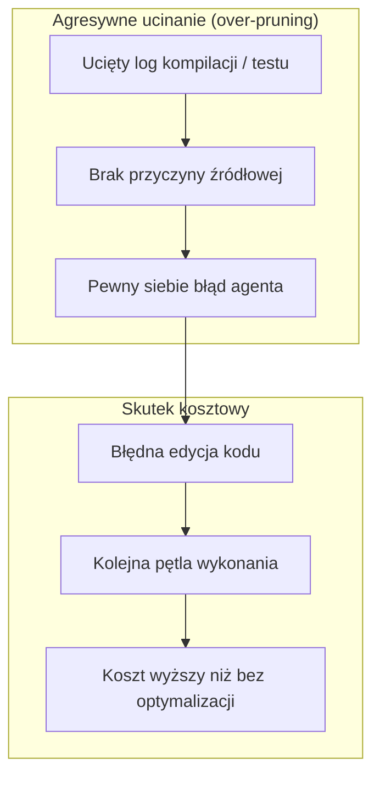

# Raport i podręcznik: bezpieczna oszczędność tokenów w pracy z agentami AI

> **Cel:** ocena jakościowa narzędzi redukcji tokenów (czy nie ucinają zbyt wiele?) oraz praktyczny poradnik optymalizacji kontekstu w Claude Code i podobnych agentach.
> **Weryfikacja źródeł:** stan repozytoriów sprawdzony na GitHubie w dniu 2026-10-17 (opis, README, struktura katalogów).
> **Jak czytać oceny:** każda teza jest oznaczona jako **[twórca]** — to deklaracja autora narzędzia z jego README, której tu nie powtórzyłem pomiarem — albo **[ocena własna]** — wniosek z analizy, nieoparty na benchmarku.

---

## 1. Paradoks oszczędności tokenów

> Jeśli zaoszczędzisz 2 000 tokenów na logach błędu, ale model przez to nie zrozumie przyczyny awarii, podejmie błędną próbę naprawy. Kolejne tury naprawcze i ponowne odczyty kontekstu mogą spalić wielokrotnie więcej. *(Przykład ilustracyjny, nie pomiar.)*



---

## 2. System świateł: ocena ryzyka jakościowego

Ocena łączy deklaracje twórców z oceną własną. Kolumna „Źródło” prowadzi do repozytorium.

| Status | Narzędzie / technika | Ryzyko dla jakości | Zalecenie |
| :---: | :--- | :--- | :--- |
| 🟢 | Standard `SKILL.md` z progressive disclosure | Brak — wiedza ładowana na żądanie | Standard w każdym projekcie |
| 🟢 | Zwięzłe flagi CLI (`git status -s`, `--stat`, `--bail`) | Brak — ograniczenie po stronie narzędzia | Domyślnie w skryptach agenta |
| 🟢 | Ochrona prefiksu prompt cache | Brak | Standard architektury promptu |
| 🟡 | [`ppgranger/token-saver`](https://github.com/ppgranger/token-saver) | Niskie–średnie: parser znający format wyjścia; zmiana formatu narzędzia może go zmylić | Dobry pierwszy wybór dla filtrowania CLI; przejrzyj kod przed instalacją |
| 🟡 | [`rtk-ai/rtk`](https://github.com/rtk-ai/rtk) | Średnie: m.in. `cat`/`read` zwraca sygnatury zamiast pełnych ciał, `git diff` z ograniczonym kontekstem | Stosuj z zasadą fallbacku (ponów bez filtra) |
| 🟡 | [`mksglu/context-mode`](https://github.com/mksglu/context-mode) | Średnie: model musi wiedzieć, o co zapytać indeks | Duże logi i dokumentacja, nie edycja małych plików |
| 🟡 | [`undefdev/token-efficiency`](https://github.com/undefdev/token-efficiency) | Tunelowe widzenie przy wycinkach plików | Zawsze dwuetapowo: nagłówek, potem fragment |
| 🟡 | [`JuliusBrussee/caveman`](https://github.com/JuliusBrussee/caveman) | Zależy od trybu; zob. 3.1 | Tylko tryb odpowiedzi; nie do debugowania i architektury |
| 🔴 | [`microsoft/LLMLingua`](https://github.com/microsoft/LLMLingua) na kodzie | Wysokie: usunięcie jednego znaku zmienia sens kodu **[ocena własna]** | Nie stosować do kodu źródłowego |

**Uwaga o bezpieczeństwie łańcucha dostaw:** `token-saver`, `rtk`, `context-mode` i `caveman` instalują hooki i/lub serwery MCP, więc widzą polecenia i wyjście z Twojego terminala. Zielone światło nie zastępuje przeglądu kodu i przypięcia wersji. Licencje: `token-saver` — Apache 2.0, `rtk` — Apache-2.0 + BUSL-1.1, `context-mode` — ELv2, `caveman` — Apache-2.0 (wg README każdego z nich).

---

## 3. Szczegółowa ocena narzędzi

### 3.1. `JuliusBrussee/caveman`
- **Co robi [twórca]:** w wersji 4.0 to sześć komponentów: zwięzły styl odpowiedzi („Say less”), kompresja czytanych logów/JSON/wyników testów („Read less”), automatyczny dobór modelu i wysiłku („Auto”, wymaga darmowego konta), zapamiętywane skrypty („Blocks”), poprawki marnotrawstwa (m.in. utrzymanie cache) oraz kompresja stron WWW („Browse”). Każdy komponent da się wyłączyć osobno.
- **Deklarowane wyniki [twórca]:** 33,2% mniej tokenów wejściowych w 54 uruchomieniach Claude Code (18/18 odpowiedzi poprawnych); A/B JetBrains na 86 zadaniach — brak mierzalnej utraty jakości (p = 0,82), 8,5% mniej tokenów wyjściowych; praca Adobe Research o stylu „caveman”. Twórca sam cytuje wniosek Adobe, że stylizowanie *Twojego* promptu pogarsza odpowiedzi, dlatego narzędzie go nie dotyka.
- **Moja ocena [ocena własna]:** wcześniejsze „unikać” było zbyt kategoryczne wobec wersji 4.0, ale wyniki pochodzą od twórcy i zewnętrznych wpisów, których tu nie powtarzałem. Telegraficzny styl w trakcie debugowania i przeglądu architektury nadal grozi pominięciem uzasadnień — traktuj tryb głosowy jako opcję dla prostych zadań. Instalator konfiguruje 30+ agentów naraz, więc przejrzyj, co zmienia (`npx @caveman-ai/cli@latest` pokazuje zmiany przed zatwierdzeniem **[twórca]**).

### 3.2. `rtk-ai/rtk` (Rust Token Killer)
- **Co robi [twórca]:** pojedynczy binarny proxy w Rust, ponad 100 obsługiwanych poleceń, narzut <10 ms. Testy (`cargo test`, `npm test`, `pytest`, `go test`) pokazują tylko błędy, `git log` skraca do skrótu, autora i tematu, `cat`/`read` zwraca strukturę zamiast pełnych ciał.
- **Co twórca mówi o oszczędnościach [twórca]:** redukcja dotyczy wyjścia basha, które jest tylko częścią tokenów wejściowych, więc rachunek rośnie mniej niż procent redukcji; liczby tokenów to szacunek `bajty / 4`.
- **Ryzyko [ocena własna]:** prosty filtr może uciąć ostrzeżenie poprzedzające błąd kompilatora; `git diff` z ograniczonym kontekstem i `cat` z samymi sygnaturami to dokładnie scenariusz tunelowego widzenia. Zawsze miej plan „ponów bez filtra”.
- **Uwaga:** na crates.io istnieje inny projekt o nazwie „rtk”. README każe sprawdzić `rtk gain` po instalacji.

### 3.3. `ppgranger/token-saver`
- **Co robi [twórca]:** 36 procesorów dla `git`, `pytest`, `jest`, `cargo`, `docker`, `kubectl`, `terraform` i innych; lokalnie, bez wywołań sieciowych w ścieżce kompresji. Obsługuje Claude Code i Antigravity CLI.
- **Gwarancje [twórca]:** pliki źródłowe (`cat *.py`) przechodzą bez zmian; wynik, który nie jest mniejszy, jest odrzucany na rzecz oryginału; mały output nie jest ruszany; hook działa fail-open (błąd narzędzia = zwykłe wykonanie polecenia). Testy awarii przechodzą przez każdy procesor przy każdym kodzie wyjścia. Twórca zastrzega: „to ochrona na przetestowanych formatach, nie uniwersalna gwarancja bezstratności”.
- **Znane ograniczenia [twórca]:** nie obsługuje złożonych pipelines, przekierowań i `||`; diffy z wieloma małymi hunkami nie są redukowane; `.env` przechodzi bez redakcji.
- **Ocena [ocena własna]:** najbardziej konserwatywny z filtrów, ale mały projekt (154 gwiazdki) — przejrzyj kod hooka i przypnij wersję.

### 3.4. `mksglu/context-mode`
- **Co robi [twórca]:** serwer MCP + hooki; duże wyniki narzędzi trafiają do lokalnego SQLite (FTS5, wyszukiwanie BM25), do kontekstu wraca streszczenie. Deklaruje 98% redukcji (315 KB → 5,4 KB). Śledzi też zdarzenia sesji, by przetrwać kompaktowanie; bez `--continue` dane poprzedniej sesji są usuwane.
- **Ryzyko [ocena własna]:** model musi wiedzieć, o co zapytać indeks (igła w stogu siana). Rejestruje 11 narzędzi MCP i 6 hooków, co zwiększa powierzchnię narzędzi w sesji. Licencja ELv2 nie jest permisywną licencją open source.

### 3.5. `undefdev/token-efficiency`
- **Co robi [twórca]:** skill uczący agenta użycia `jq`/`yq`/`awk`, `ast-grep`/`rg`, `git --stat`, wyciszania szumu przy zachowaniu błędów i kodu wyjścia. Instalacja: `/plugin marketplace add undefdev/token-efficiency`.
- **Uwaga twórcy:** README zapowiada wycofanie projektu, gdy modele przejmą te praktyki jako domyślne.
- **Ryzyko [ocena własna]:** czytanie samych wycinków prowadzi do pominięcia importów i typów — stosuj zasadę dwuetapową z sekcji 5.

### 3.6. `microsoft/LLMLingua`
- **Co robi [twórca]:** kompresja promptu i KV-cache małym modelem, deklarowane do 20× przy minimalnej utracie jakości (prace EMNLP'23, ACL'24).
- **Ocena [ocena własna]:** deklaracja dotyczy tekstu naturalnego. Dla kodu nie sprawdzałem benchmarków; usunięcie znaku interpunkcyjnego zmienia semantykę programu, więc nie używaj do kodu źródłowego.

---

## 4. Katalog skilli

### 4.1. Oficjalne skille Anthropic — [`anthropics/skills`](https://github.com/anthropics/skills)
Katalog `skills/` zawiera (sprawdzone): `skill-creator`, `frontend-design`, `doc-coauthoring`, `mcp-builder`, `webapp-testing`, `claude-api`, `docx`, `pdf`, `pptx`, `xlsx` i inne.

| Skill | Po co w kontekście oszczędzania tokenów |
| :--- | :--- |
| [`skill-creator`](https://github.com/anthropics/skills/tree/main/skills/skill-creator) | Budowa zwięzłych skilli w modelu progressive disclosure |
| [`frontend-design`](https://github.com/anthropics/skills/tree/main/skills/frontend-design) | Zasady UI w skillu zamiast powtarzanych wyjaśnień w promptach |
| [`doc-coauthoring`](https://github.com/anthropics/skills/tree/main/skills/doc-coauthoring) | Iteracyjne tworzenie dokumentacji zamiast jednego wielkiego zrzutu |
| [`mcp-builder`](https://github.com/anthropics/skills/tree/main/skills/mcp-builder) | Wzorce serwerów MCP; zwięzłe schematy narzędzi zmniejszają koszt definicji |

Powyższa kolumna „Po co” to moja interpretacja [ocena własna], nie deklaracja Anthropic.

### 4.2. Skille inżynierskie ze społeczności
Nazwy z pierwotnego planu (`tdd-workflow`, `refactoring-planner`, `conventional-commits`, `pr-review-checklist`) **nie zostały znalezione** jako uznane skille — wyszukiwanie na GitHubie dało tylko zerogwiazdkowe repozytoria o podobnych nazwach. Zweryfikowane odpowiedniki:

| Potrzeba | Zweryfikowany skill |
| :--- | :--- |
| TDD | [`obra/superpowers` → `test-driven-development`](https://github.com/obra/superpowers/tree/main/skills/test-driven-development) |
| Plan przed zmianą kodu | [`obra/superpowers` → `writing-plans`](https://github.com/obra/superpowers/tree/main/skills/writing-plans) i `executing-plans` |
| Przegląd kodu | [`obra/superpowers` → `requesting-code-review`](https://github.com/obra/superpowers/tree/main/skills/requesting-code-review) |
| Changelog z commitów | [`ComposioHQ/awesome-claude-skills` → `changelog-generator`](https://github.com/ComposioHQ/awesome-claude-skills/tree/master/changelog-generator) |
| Oszczędność tokenów w użyciu narzędzi | [`undefdev/token-efficiency`](https://github.com/undefdev/token-efficiency) |

Przeglądy list: [`ComposioHQ/awesome-claude-skills`](https://github.com/ComposioHQ/awesome-claude-skills), [`travisvn/awesome-claude-skills`](https://github.com/travisvn/awesome-claude-skills). Samego mechanizmu oszczędzania `superpowers` nie sprawdzałem — to ogólny framework metodyki, więc jego skille same zużywają kontekst.

---

## 5. Matryca decyzyjna: co ciąć, a czego strzec

| Element kontekstu | Tolerancja na ucinanie | Bezpieczna metoda | Czego nie robić |
| :--- | :--- | :--- | :--- |
| Paski postępu CLI | 100% | Flagi `--silent`, filtry CLI | Zostawiać w kontekście |
| Sukcesy w testach | Bardzo wysoka | Pokazywać tylko nieudane | Ucinać podsumowania (liczba faili) |
| Stack trace, błędy kompilacji | Zero | Pełny błąd + powiązane linie | `head -n 20`, naiwny regex |
| Pliki źródłowe | Niska | Dwuetapowo: importy/sygnatury → fragment | Edytować bez wglądu w importy i typy |
| `CLAUDE.md` | Średnia | Procedury do `SKILL.md` | Wklejać całą dokumentację |
| Prompt cache | Krytyczna | Niezmienny prefiks | Zmieniać narzędzia MCP w trakcie sesji |

---

## 6. Playbook przed/po

Liczby w scenariuszu A i B pochodzą z tabeli „Before & After” w README `token-saver` (liczone przez twórcę, oszacowanie tokenów). Scenariusz C jest przykładem szacunkowym.

### Scenariusz A: stan repozytorium
- **Naiwnie:** pełny `git diff` przy wielu zmienionych plikach — `token-saver` podaje 2 270 tokenów dla 5 plików z 20 liniami kontekstu **[twórca]**.
- **Zoptymalizowane:**
  1. `git status -s`
  2. `git diff --stat` — przy 25 plikach 526 → 21 tokenów po kompresji **[twórca]**; sam `--stat` jest już zwięzły
  3. `git diff -- ścieżka/pliku` tylko dla pliku, który edytujesz

### Scenariusz B: testy
- **Naiwnie:** pełne wyjście `pytest` (500 testów, 2 błędy) — 6 744 tokenów.
- **Zoptymalizowane:** po kompresji 307 tokenów (95%) przy zachowanych błędach **[twórca]**. Bez narzędzi: `--bail` / `-x` i wyciszone raportowanie.

### Scenariusz C: duży plik JSON *(szacunek ilustracyjny)*
- **Naiwnie:** wczytanie całego `package-lock.json` do kontekstu — dziesiątki tysięcy tokenów.
- **Zoptymalizowane:** `jq '.dependencies | keys' package.json` zwraca kilkadziesiąt–kilkaset tokenów. Dokładna oszczędność zależy od pliku.

---

## 7. Podręcznik: sześć zasad

### Zasada 1: `SKILL.md` i progressive disclosure
W pliku głównym (`CLAUDE.md`) trzymaj mapę projektu, krytyczne zakazy i odesłania; procedury specjalistyczne wydziel do skilli:
```text
.claude/skills/nazwa-skilla/
├── SKILL.md          # YAML (name + description) + instrukcja
└── references/       # ładowane tylko na żądanie
```
Na starcie agent widzi tylko `name` i `description` — wg README `ComposioHQ/awesome-claude-skills` to ok. 100 tokenów na skill, a treść (zwykle <5 000 tokenów) ładuje się dopiero przy dopasowaniu zadania.

### Zasada 2: ochrona prefiksu prompt cache
Odczyt z cache Anthropic kosztuje ułamek ceny bazowej (zob. oficjalną dokumentację cennika i prompt caching, linkowaną w README projektu). Aby cache działał:
- nie wstrzykuj zmiennych danych (czas, losowe ID, status gita) na początek promptu;
- pamiętaj o TTL: domyślnie 5 minut, opcjonalnie dłużej — po wygaśnięciu kolejna tura płaci pełną cenę za cały kontekst;
- nie włączaj ani nie wyłączaj serwerów MCP w trakcie sesji — zmienia to definicje narzędzi i unieważnia cache.

### Zasada 3: higiena narzędzi terminalowych
Preferuj `git status -s`, `git diff --stat`, `--bail`. Przy narzędziu kompresującym ustaw regułę: gdy przyczyna błędu jest niejasna, uruchom polecenie ponownie bez filtra.

### Zasada 4: dwuetapowa edycja kodu
1. Przejrzyj import i sygnatury (początek pliku lub zarys symboli).
2. Odczytaj docelowy blok.
3. Wykonaj precyzyjną zamianę.

### Zasada 5: ukierunkowane `/compact`
Przy 70–80% okna nie czekaj na automatyczne kompaktowanie:
```text
/compact Zachowaj tylko: stan zadań, listę zmodyfikowanych plików, napotkane błędy i decyzje projektowe. Odrzuć surowe logi i wcześniejszą dyskusję.
```
Po zakończeniu zadania zapisz podsumowanie w `docs/progress.md` i zacznij kolejne w czystej sesji.

### Zasada 6: filtrowanie danych u źródła
`jq '.items[] | {id, name}'` zamiast `cat response.json`; `grep -E "ERROR|WARN"` zamiast całego logu.

---

## 8. Szablony

### 8.1. Szablon bezpiecznego `SKILL.md`
Gotowy plik: [`templates/token-efficiency/SKILL.md`](templates/token-efficiency/SKILL.md). Zawiera frontmatter z precyzyjnym opisem wyzwalacza, odesłanie do `references/` oraz sekcję procedury awaryjnej.

**Gdzie go umieścić:** skill globalny (dla wszystkich projektów) — `~/.claude/skills/token-efficiency/SKILL.md`; skill projektowy — `.claude/skills/token-efficiency/SKILL.md` w katalogu projektu.

### 8.2. Aliasy powłoki
Aliasy z `.bashrc` nie działają w nieinteraktywnej powłoce, której używa agent, więc **same aliasy nie wystarczą**. Użyj skryptów w `PATH` albo wpisz polecenia do `CLAUDE.md`:
```bash
# ~/.local/bin/gt  — zwięzły status gita
#!/usr/bin/env bash
git status -s && git diff --stat

# ~/.local/bin/nt  — testy do pierwszego błędu
#!/usr/bin/env bash
npm test -- --bail --silent "$@" || { echo "Test failed; rerun without filter if cause is unclear" >&2; exit 1; }
```
Dostosuj polecenie testów do projektu (`pytest -x -q`, `cargo test` itd.).

---

## 9. Rekomendacje wdrożeniowe

| Obszar | Co wdrożyć od zaraz | Narzędzie / podejście |
| :--- | :--- | :--- |
| Filtrowanie CLI | Selektywne parsowanie komend | `token-saver` (po przeglądzie kodu) lub flagi `--bail` / `-s` |
| Architektura reguł | Trójstopniowe `SKILL.md` | Progressive disclosure |
| Higiena promptu | Ochrona prefiksu cache | Statyczny prefiks, brak losowych zmiennych |
| Styl agenta | Rzeczowe odpowiedzi | Zwięzłe instrukcje w `CLAUDE.md`; tryb `caveman` tylko świadomie |
| Zarządzanie sesją | Postęp w plikach | `docs/progress.md` + świeża sesja na zadanie |
