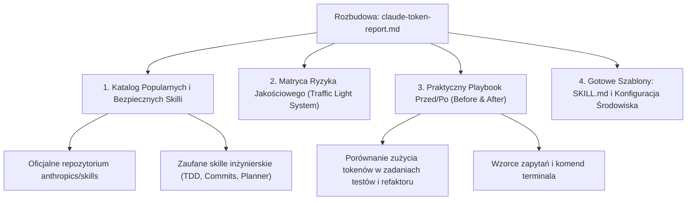

# Szczegółowy Plan Rozbudowy Raportu: Bezpieczne Skille i Praktyczny Poradnik Oszczędzania Tokenów

> **Dokument powiązany:** [claude-token-report.md](claude-token-report.md)  
> **Status:** ZATWIERDZONY i zrealizowany 2026-10-17 (z poprawkami poniżej).
>
> **Poprawki po przeglądzie:** dokument przeniesiony do repo (`docs/`); sekcja 5 (`velo-ad-studio`) usunięta; narzędzia zweryfikowane na GitHubie i podlinkowane, a tezy twórców oznaczone jako deklaracje twórców; nazwy skilli społeczności, których nie znaleziono (`tdd-workflow`, `refactoring-planner`, `conventional-commits`, `pr-review-checklist`), zastąpiono zweryfikowanymi odpowiednikami; szablon `SKILL.md` trafia do `~/.claude/skills/`.

---

## 1. Cel i Założenia Rozbudowy

Obecny raport diagnozuje mechanizmy rynkowe i ostrzega przed „Paradoksem Oszczędności Tokenów”. Rozbudowa ma na celu przekształcenie go w **gotowy do wdrożenia podręcznik inżynierski (Playbook)**, który:
1. Prezentuje **sprawdzone, popularne i w 100% bezpieczne skille** (oficjalne od Anthropic i zaufane z repozytoriów społeczności).
2. Zastępuje ogólne porady **konkretnymi wzorcami przed/po (Before & After)**, szablonami promptów, aliasami shella i strukturami `SKILL.md`.
3. Wprowadza **system weryfikacji ryzyka (Traffic Light System)** dla każdego narzędzia.

---

## 2. Nowe Sekcje do Wdrożenia w Raporcie

---

### Sekcja 1: Katalog Popularnych i Bezpiecznych Skilli (Verified & Safe Registry)

W tej sekcji skatalogujemy skille, które **zmniejszają zużycie tokenów, nie niszcząc rozumowania i bezpieczeństwa kodu**:

1. **Oficjalne Skille Anthropic (`anthropics/skills`):**
   - **`skill-creator`:** Oficjalny meta-skill Anthropic do budowy własnych, zwięzłych skilli w standardzie Progressive Disclosure (zapobiega tworzeniu przeładowanych promptów).
   - **`frontend-design`:** Wymusza precyzyjne zasady UI/UX bez generowania tysięcy linii powtarzalnego kodu CSS.
   - **`doc-coauthoring`:** Ustrukturyzowany proces współtworzenia dokumentacji technicznej w krótkich, iteracyjnych pętlach zamiast jednorazowych gigantycznych zrzutów.
   - **`mcp-builder`:** Wzorzec tworzenia serwerów MCP ze zoptymalizowanymi schematami narzędzi (oszczędność w definicjach narzędzi).

2. **Skille Inżynierskie ze Społeczności** *(nazwy poniżej to pierwotne założenie planu — nie wszystkie istnieją; zweryfikowane odpowiedniki są w sekcji 4.2 raportu)*:
   - **`tdd-workflow` (Test-Driven Development):**
     * *Dlaczego oszczędza tokeny?* Wymusza pisanie minimalnego testu i minimalnej implementacji. Eliminuje pętlę „wygeneruj 400 linii kodu → nie działa → generuj kolejne 400 linii”.
   - **`refactoring-planner`:**
     * *Dlaczego oszczędza tokeny?* Wymusza zatwierdzenie planu przed dotknięciem kodu. Zapobiega nieudanym edycjom i wielokrotnym wywołaniom narzędzi `replace_file_content`.
   - **`conventional-commits`:**
     * *Dlaczego oszczędza tokeny?* Zamiast wczytywać całą historię i dyskutować o opisie commitu, analizuje wyłącznie `git diff --staged --stat` i generuje 1-linijkowy zwięzły opis.
   - **`pr-review-checklist`:**
     * *Dlaczego oszczędza tokeny?* Przeprowadza ukierunkowany audyt według punktów kontrolnych bez powtórnego czytania całego projektu.
   - **`token-efficiency` (`undefdev`):**
     * Zoptymalizowany zestaw reguł: używanie `jq`, pobieranie wycinków plików, zrównoleglanie narzędzi read-only.

---

### Sekcja 2: Matryca Ryzyka Jakościowego (Traffic Light System)

Precyzyjna klasyfikacja narzędzi i technik pod kątem bezpieczeństwa produkcji:

| Status | Narzędzie / Technika | Wpływ na jakość | Rekomendacja użycia |
| :---: | :--- | :--- | :--- |
| 🟢 **ZIELONE (Safe)** | **Standard `SKILL.md` (Progressive Disclosure)** | **Zero ryzyka.** Wczytuje wiedzę tylko wtedy, gdy jest potrzebna. | Standard dla każdego projektu. |
| 🟢 **ZIELONE (Safe)** | **`ppgranger/token-saver`** | **Zero ryzyka.** Parsuje strukturę CLI, zachowuje 100% stack trace'ów. | Rekomendowane do testów (`pytest`, `jest`, `cargo`). |
| 🟢 **ZIELONE (Safe)** | **Zwięzłe flagi CLI (`--bail`, `-s`, `--stat`)** | **Zero ryzyka.** Ogranicza wyjście na poziomie natywnym narzędzia. | Obowiązkowe w skryptach agenta. |
| 🟢 **ZIELONE (Safe)** | **Ochrona Prompt Caching (Statyczny prefiks)** | **Zero ryzyka.** Daje 90% rabatu na powtarzające się zapytania. | Standard architektury promptu. |
| 🟡 **ŻÓŁTE (Caution)** | **`rtk-ai/rtk` (CLI Proxy z regexami)** | **Średnie ryzyko.** Może uciąć ostrzeżenia kompilatora poprzedzające błąd. | Stosować z zasadą fallbacku (jeśli test padnie, ponów bez filtra). |
| 🟡 **ŻÓŁTE (Caution)** | **Slicing kodu (`StartLine` / `EndLine`)** | **Średnie ryzyko.** Ryzyko „tunelowego widzenia” (brak importów/typów). | Stosować zawsze w trybie dwuetapowym (nagłówek + funkcja). |
| 🟡 **ŻÓŁTE (Caution)** | **`mksglu/context-mode` (SQLite Sandbox)** | **Średnie ryzyko.** Może nie trafić w wyszukiwanie BM25/FTS5. | Stosować do wielkich logów i dokumentacji, nie do kodu. |
| 🔴 **CZERWONE (Avoid)** | **`JuliusBrussee/caveman` (Styl telegraficzny)** | **Wysokie ryzyko.** Niszczy Chain-of-Thought, pomija edge-cases i architekturę. | Unikać przy programowaniu i refaktoryzacji. |
| 🔴 **CZERWONE (Avoid)** | **`LLMLingua` na kodzie źródłowym** | **Krytyczne ryzyko.** Usuwa znaki interpunkcyjne i składnię kodu. | Całkowity zakaz stosowania do języków programowania. |

---

### Sekcja 3: Praktyczny Playbook Przed / Po (Before & After)

Zestawienie realnych scenariuszy pokazujące różnicę w zużyciu tokenów:

#### Scenariusz A: Sprawdzenie stanu repozytorium i diffa
- **Podejście naiwne:** Uruchomienie `git status` i `git diff` bez ograniczeń na projekcie z 15 zmienionymi plikami → **12 500 tokenów** wpompowane w kontekst.
- **Podejście zoptymalizowane:**
  1. `git status -s` (zaledwie 12 linii = ~80 tokenów).
  2. `git diff --stat` (podsumowanie zmian = ~150 tokenów).
  3. Precyzyjny `git diff -- path/to/file.ts` tylko dla modyfikowanego pliku (~400 tokenów).
  - **Oszczędność: 95% tokenów**, przy 100% zachowaniu informacji.

#### Scenariusz B: Uruchamianie testów i lintera
- **Podejście naiwne:** `npm test` drukujący 800 linii udanych testów i paski postępu → **8 000 tokenów**.
- **Podejście zoptymalizowane:** `npm test -- --bail --silent` (lub użycie `token-saver`) → **350 tokenów** (tylko pojedynczy nieudany test ze stack trace'em).
  - **Oszczędność: 95% tokenów**, zero szumu.

#### Scenariusz C: Badanie dużego pliku konfiguracyjnego JSON (np. `package-lock.json` lub plik danych)
- **Podejście naiwne:** `view_file` na pliku 4 000 linii → **25 000 tokenów** (połowa pamięci roboczej agenta).
- **Podejście zoptymalizowane:** `jq '.dependencies | keys' package.json` → **120 tokenów**.
  - **Oszczędność: 99.5% tokenów**.

---

### Sekcja 4: Gotowe Szablony Konfiguracyjne i `SKILL.md`

W raporcie umieścimy gotowe do skopiowania szablony:
1. **Szablon bezpiecznego `SKILL.md`:**
   - Poprawnie skonstruowany YAML frontmatter (trigger contract).
   - Zasada odsyłania do podfolderu `references/` zamiast wklejania wiedzy do korpusu.
   - Sekcja procedury awaryjnej (Fallback).
2. **Plik aliasów powłoki / konfiguracji dla agenta (`.agent-env`):**
   - Zdefiniowane bezpieczne aliasy komend (`gt` dla zwięzłego gita, `nt` dla cichych testów).

---

### Sekcja 5: usunięta

Wdrożenie w `velo-ad-studio` wycięto na polecenie użytkownika.

---

## 3. Proponowane Kroki Wykonawcze

1. **Krok 1 (DONE):** Akceptacja planu przez Użytkownika (ewentualne uwagi co do narzędzi).
2. **Krok 2 (DONE):** Aktualizacja i rozbudowa pliku [claude-token-report.md](claude-token-report.md) o powyższe sekcje, diagramy, tabele i przykłady.
3. **Krok 3 (DONE):** Przygotowanie gotowego szablonu `.claude/skills/token-efficiency/SKILL.md` dopasowanego do specyfiki środowiska.
